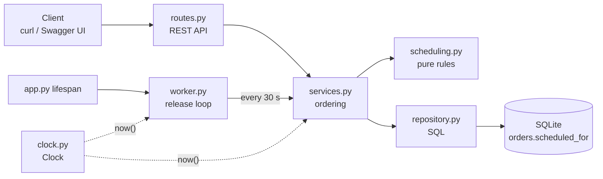

# Design — Track A: Scheduled Orders

## Components touched

The feature stays inside the existing layered, single-deployable structure
(routes → services → repository → SQLite). New logic goes into small modules with one job each.

| Module | Change | Responsibility |
|---|---|---|
| `clock.py` | **new** | `Clock` protocol (`now() -> datetime`) and `SystemClock`. The only place real time is read. |
| `scheduling.py` | **new** | Pure domain rules, no I/O: `validate_schedule()`, `is_open_at()`, `release_cutoff()`, `to_db()`. |
| `worker.py` | **new** | `run_release_loop()`: an asyncio loop that calls "release due orders" every N seconds until stopped. |
| `services.py` | changed | `place_order()` validates `scheduled_for`; new `release_due_orders()` and `cancel_order()`; `update_status()` guards `SCHEDULED`. |
| `repository.py` | changed | Insert `scheduled_for`; atomic `release_scheduled_orders()` and `cancel_if_scheduled()`. |
| `db.py` | changed | `migrate()` adds the `scheduled_for` column to existing databases. |
| `routes.py` | changed | `POST /orders` accepts `scheduled_for`; new `POST /orders/{id}/cancel`. |
| `schemas.py` | changed | `SCHEDULED` status; `scheduled_for` on request and response. |
| `app.py` | changed | Takes a `Clock`; starts/stops the release loop in the FastAPI lifespan. |

## Interfaces

### `POST /orders` (extended)
Request adds an optional field:
```json
{ "restaurant_id": 5, "items": [{"menu_item_id": 9, "quantity": 1}],
  "address": "1 Main St", "scheduled_for": "2026-11-01T18:00:00Z" }
```
- No `scheduled_for` → 201, status `PLACED` (unchanged).
- Valid `scheduled_for` → 201, status `SCHEDULED`, `scheduled_for` echoed in UTC.
- Invalid → 422 with `error.code` one of `SCHEDULE_TIMEZONE_REQUIRED`, `SCHEDULE_TOO_SOON`,
  `SCHEDULE_TOO_FAR`, `RESTAURANT_CLOSED`.

### `POST /orders/{id}/cancel` (new)
- `SCHEDULED` → 200, status `CANCELLED`.
- Any other status → 409 `ORDER_NOT_CANCELLABLE`. Unknown id → 404 `ORDER_NOT_FOUND`.

### `PATCH /orders/{id}/status` (guarded)
- Changing a `SCHEDULED` order, or setting `SCHEDULED`, → 409 `STATUS_CHANGE_NOT_ALLOWED`.

### Domain functions (`scheduling.py`)
```python
validate_schedule(scheduled_for: datetime, now: datetime, opens_at: str, closes_at: str) -> datetime
    # Pre:  now is timezone-aware UTC; opens_at/closes_at are "HH:MM"
    # Post: returns scheduled_for converted to UTC, or raises ValidationFailedError with
    #       SCHEDULE_TIMEZONE_REQUIRED | SCHEDULE_TOO_SOON | SCHEDULE_TOO_FAR | RESTAURANT_CLOSED
is_open_at(opens_at: str, closes_at: str, t: time) -> bool   # [open, close), wraps midnight
release_cutoff(now: datetime) -> datetime                     # now + 30 minutes
```

## Data changes

- `orders.scheduled_for TEXT NULL` — UTC timestamp written by `to_db()` in one fixed-width format
  (`2026-11-01T18:00:00.000000+00:00`), so SQLite can compare timestamps as text.
  `NULL` means "deliver as soon as possible" (every baseline order).
- New status value `SCHEDULED`. Lifecycle: `SCHEDULED → PLACED` (release) or
  `SCHEDULED → CANCELLED` (customer cancel). From `PLACED` on, the baseline flow is unchanged.
- `created_at` is now also written with `to_db()` from the injected clock.
- Migration: `db.migrate()` runs on startup; if `orders` has no `scheduled_for` column it runs
  `ALTER TABLE orders ADD COLUMN scheduled_for TEXT`. It is idempotent and existing rows get
  `NULL`, so old orders are unaffected.

## Diagrams

### Components



### Lifecycle of a scheduled order

```mermaid
sequenceDiagram
    participant C as Customer
    participant API as routes / services
    participant S as scheduling.py
    participant DB as SQLite
    participant W as Release loop

    C->>API: POST /orders {scheduled_for}
    API->>S: validate_schedule(scheduled_for, clock.now(), hours)
    S-->>API: UTC time (or 422 error code)
    API->>DB: INSERT status=SCHEDULED
    API-->>C: 201 SCHEDULED
    loop every 30 seconds
        W->>API: release_due_orders(clock.now())
        API->>DB: UPDATE status=PLACED WHERE status=SCHEDULED AND scheduled_for <= now+30m
    end
    Note over DB: the single UPDATE matches each order once;<br/>a second run finds nothing to change
    C->>API: POST /orders/{id}/cancel
    API->>DB: UPDATE status=CANCELLED WHERE id=? AND status=SCHEDULED
    API-->>C: 200 CANCELLED, or 409 if already released
```

## ADR-001: Release scheduled orders with an in-app background loop

**Status:** Accepted

**Context.** A `SCHEDULED` order must move to `PLACED` 30 minutes before delivery, exactly once
(AC7), and must never move if it was cancelled (AC9). MiniDash is a single FastAPI process on
SQLite, run by one person, with tests that must not depend on real time (AC12). Whatever triggers
the release has to be testable with a fake clock and must not double-release if it runs twice.

**Options considered.**

1. **In-app asyncio loop + atomic SQL update.** A pure function
   `release_due_orders(conn, now)` runs one `UPDATE … WHERE status='SCHEDULED' AND
   scheduled_for <= now+30m`. A small asyncio task started in the FastAPI lifespan calls it every
   30 seconds.
2. **APScheduler library.** Schedule one job per order (or one interval job) with APScheduler.
3. **External trigger endpoint.** Expose `POST /internal/release-due`; a cron job or script calls it.

**Decision.** Option 1.

**Consequences.**
- \+ No new dependency (no package to vet, pin, or keep updated).
- \+ Exactly-once comes from the database, not the timer: the `WHERE status='SCHEDULED'` filter
  means a second run, or a run racing with a cancel, finds nothing to change. The release logic is
  a plain function, tested with a fixed clock and no sleeping.
- \+ Restart-safe: state lives in the `orders` table, so a restart simply catches up on the next
  tick.
- − Release can be up to one interval (30 s) late. Acceptable for a 30-minute kitchen lead time;
  the interval is a `create_app()` parameter.
- − Assumes one app instance. With several instances each would run the loop. The atomic update
  still prevents double release, but it would be wasted work. Revisit if we scale out.
- − The loop runs inside the web process; a crash in the loop must not kill the API, so the loop
  logs and continues on errors.

**Why not the others.** APScheduler (2) adds a dependency, and per-order jobs live in memory
unless a job store is configured, so a restart could lose them. The trigger endpoint (3) is the
simplest code, but nothing is released unless something outside the app calls it, which moves a
core requirement out of the system we test. It would also need protecting from public callers.

**Revisit when** MiniDash runs more than one instance, or needs release accuracy better than the
loop interval.

## Other decisions

- **UTC everywhere; reject naive times.** A naive `18:00` is ambiguous, so the API refuses it rather
  than guess. Per-restaurant time zones are out of scope (see requirements).
- **Dedicated cancel endpoint.** Customers cancel through `POST /orders/{id}/cancel`; the PATCH
  status endpoint stays a staff tool and is guarded so it cannot bypass the release rule (AC11).
- **Dependencies.** No new runtime dependencies. All packages are pinned in `requirements*.txt`
  and were checked on pypi.org (fastapi, uvicorn, pytest, httpx, ruff). Starlette warns that
  `httpx` is deprecated for its test client in favor of `httpx2`. We checked `httpx2` on PyPI (it is
  published from the pydantic GitHub organization) but kept the pinned `httpx` because the warning
  does not affect results. This is a follow-up item, not part of this feature.
